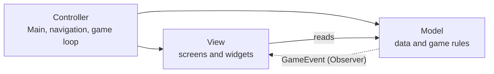
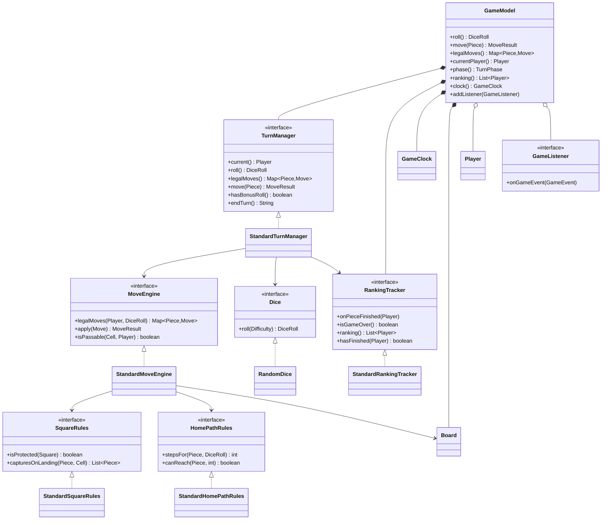
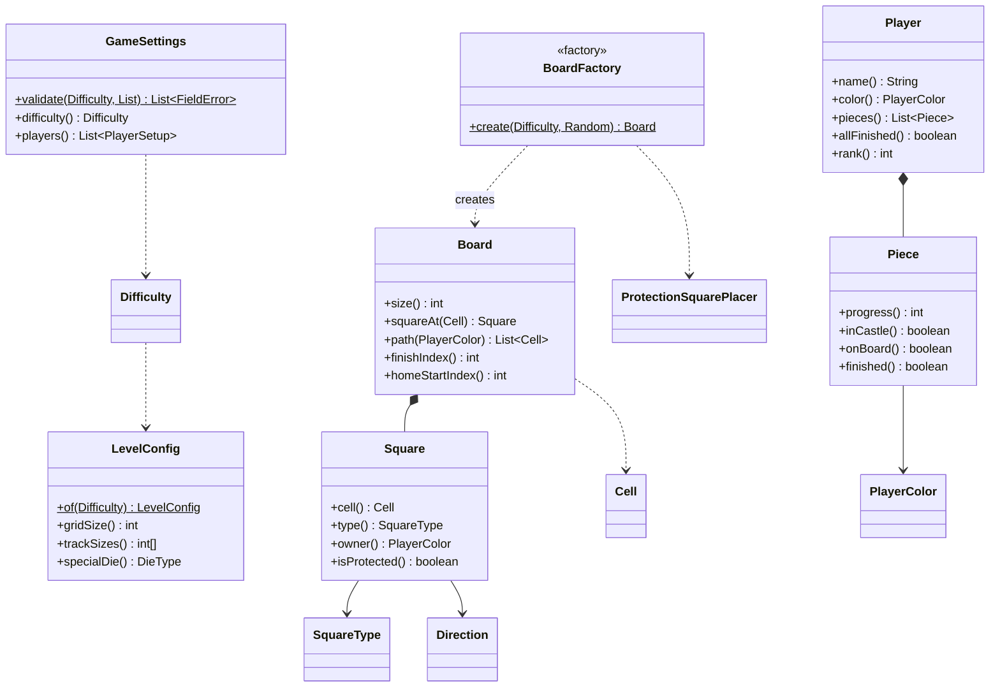
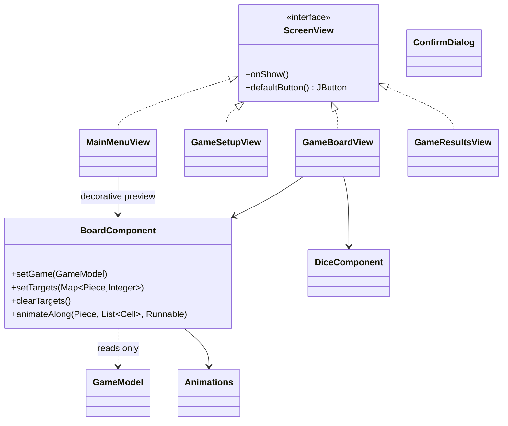
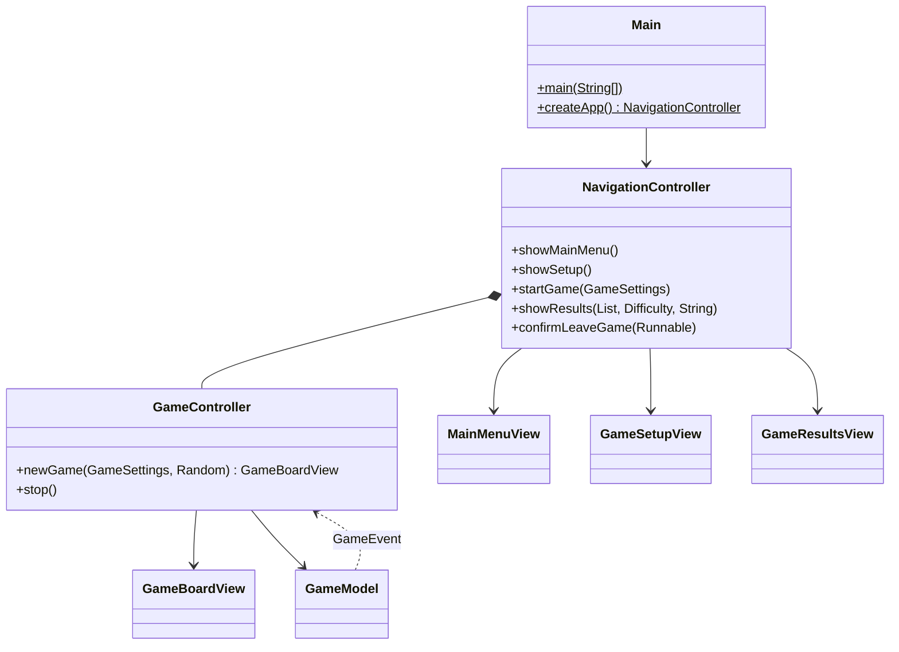
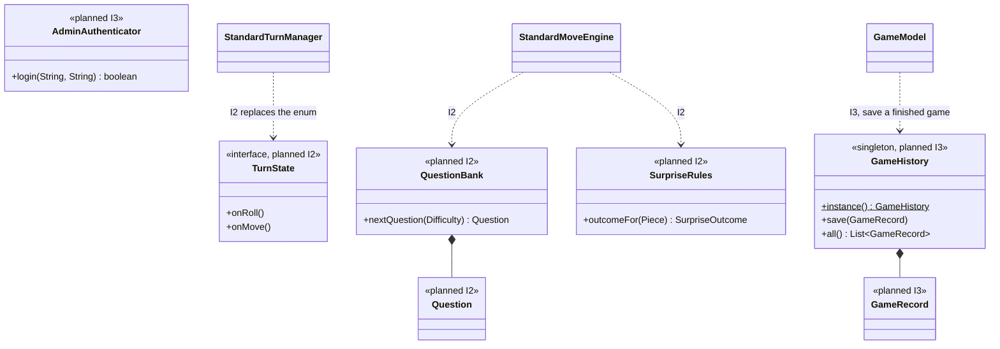

# Class diagram — Educational Ludo (Team Sharks)

Task **N04** · Owner: Mohamed Zereny · Reviewer: Rakan Ziyan (decision D3) · SRS **NFR-08, NFR-09, NFR-20**

This diagram describes the system as a whole: the classes **implemented in Iteration 1**, and the classes
**planned for Iterations 2 and 3**. Everything marked as implemented was read off the source tree at
`iteration-1` commit `3d3ce9b`; nothing here is invented.

The diagrams are written in Mermaid, which GitHub renders directly in this file.

---

## 1. Packages and the MVC rule

The code is split into the three packages the assignment asks for. The dependency rule is checked
automatically by `Iteration1/test/Architecture/MvcDependencyTest.java` (NFR-08, NFR-20):

- `Model` may not import `View` or `Controller`, and may not import Swing or AWT.
- `View` may not import `Controller`.
- Only `Model`, `View` and `Controller` exist as top-level packages.



The dotted arrow is not an import: the Model never names the View. It publishes `GameEvent` to whoever
registered as a `GameListener`, and the Controller passes the change on to the screens.

---

## 2. Model — the game rules (Iteration 1, implemented)

The Model is built around one facade, `GameModel`, and a set of interfaces that were frozen at
checkpoint CP1. Each interface has exactly one Iteration 1 implementation, named `Standard…`.



### Board and pieces



**Value types** (records and enums, no behaviour worth drawing): `Cell`, `DiceRoll`, `Move`,
`MoveResult`, `GameEvent`, `PlayerColor`, `SquareType`, `DieType`, `Direction`, `Difficulty`,
`TurnPhase`.

---

## 3. View — the screens (Iteration 1, implemented)



`View.components` holds the reusable widgets reused from the Assignment 3 prototype through the reuse
gate (SDP 6.1): `Animations`, `BoardComponent`, `ColorSwatch`, `Confetti`, `CustomButton`, `CustomPanel`,
`DiceComponent`, `GradientBackground`, `Icons`, `ModalOverlay`, `StyledTable`, `StyledTextField`,
`Theme`, `ToggleChip`, `UiKit`.

---

## 4. Controller



---

## 5. The four design patterns of NFR-09

> **NFR-09** — *Documented Design Patterns shall include Factory Method (boards), Observer (screens),
> State (turn phases), and Singleton (history file).*

| Pattern | Where | Status |
|---|---|---|
| **Factory Method** | `BoardFactory.create(Difficulty, Random)` builds the whole board for a level: grid, tracks, castles, home paths and the random protection squares via `ProtectionSquarePlacer`. The level data itself comes from `LevelConfig`, so adding Medium and Hard needs no change in the factory's callers. | **Implemented** (Iteration 1) |
| **Observer** | `GameModel` keeps a list of `GameListener`s and publishes `GameEvent`s (`STATE_CHANGED`, `ROLLED`, `MOVED`, `TURN_PASSED`, `TURN_CHANGED`, `PLAYER_FINISHED`, `GAME_OVER`). The screens refresh from those events, which is what keeps the Model free of any View import (NFR-08). | **Implemented** (Iteration 1) |
| **State** | The turn is a small state machine over `TurnPhase` (`AWAITING_ROLL → AWAITING_MOVE → MOVING / AWAITING_ROLL → GAME_OVER`), held in `StandardTurnManager`. In Iteration 1 it is an enum with the transitions written in the manager. | **Partly implemented**: the phases exist; turning them into State classes is planned for Iteration 2 (SDP, US-2.4). |
| **Singleton** | The game-history file is read and written through one shared access point, so the CSV cannot be opened twice at the same time. | **Planned for Iteration 3** (FR-48, FR-49, NFR-06). |

---

## 6. Planned for Iterations 2 and 3

Drawn as planned classes, to show where they attach to what already exists. None of these exist in the
code yet.



| Iteration | Classes to add | SRS |
|---|---|---|
| 2 | `TurnState` and its states, `QuestionBank`, `Question`, `SurpriseRules`, `SurpriseOutcome`, Double Block rules in `StandardMoveEngine`, Boost and UltraBoost in `RandomDice` | FR-05, FR-10–FR-12, FR-14, FR-16, FR-17, FR-19, FR-25–FR-30, FR-32, FR-34–FR-42 |
| 3 | `GameHistory` (Singleton), `GameRecord`, CSV storage, `AdminAuthenticator`, question management screens | FR-02, FR-48–FR-65 |

---

## 7. How to check this diagram against the code

Every class named as *implemented* is in `Iteration1/src` at commit `3d3ce9b`:

```
git ls-tree --name-only -r origin/iteration-1 Iteration1/src
```

The MVC arrows are enforced, not just documented: run `test.bat` (or `./test.sh`) and see
`MvcDependencyTest`, which fails the build if the Model ever imports the View, Swing or the Controller.

---

## 8. The submitted PDF

The deliverable for Assignment 4 is **`classDiagram_Sharks.pdf`** at the repository root: 15 pages, A3
landscape (1191 x 842 pt), drawn as real vector graphics. Pages 1-7 are the drawn diagram below; pages
8-15 are the complete class reference that Assignment 4, part 4 asks for ("all classes, the
relationships between them, and the fields and methods of every class").

| Page | Content |
|---|---|
| 1 | Title, the three packages and the MVC dependency rule, notation |
| 2 | Model — the `GameModel` facade and the CP1 contracts with their `Standard` implementations |
| 3 | Model — movement rules: `MoveEngine`, `SquareRules`, `HomePathRules`, `Board`, `Square` |
| 4 | Model — Factory Method for boards, and the settings, players and pieces of a game |
| 5 | View — `ScreenView`, the four screens, `BoardComponent` and the widgets |
| 6 | Controller — `Main`, `NavigationController`, `GameController`, and one turn end to end |
| 7 | The four design patterns of NFR-09, and the classes planned for Iterations 2 and 3 |
| 8-10 | Complete class reference — `Model`: every class, interface, record and enum with all fields and methods |
| 11 | Complete class reference — `View` (screens and their inner classes) |
| 12-13 | Complete class reference — `View.components` (widgets) |
| 14 | Complete class reference — `Controller` |
| 15 | Every relationship between two classes: generalization, realization, association (field and multiplicity), nesting |

Pages 8-15 cover 90 classes (the 58 source files and their named inner classes), 355 fields, 580
methods and 157 relationships. They are not typed by hand: `render_class_reference.py` compiles
`Iteration1/src` with `javac --release 17` and reads every class back with `javap -p`, so they always
match the code they were generated from. Anonymous classes and compiler-generated members (lambdas,
enum `values()`/`valueOf()`, record `equals`/`hashCode`/`toString`) are left out. UML notation:
`+` public, `-` private, `#` protected, `~` package; static members are underlined.

This Markdown file stays the editable source of pages 1-7. The PDF is produced from
`Iteration1/docs/render_class_diagram.py`, which needs Python, `reportlab` and a JDK on the PATH
(for pages 8-15):

```
python Iteration1/docs/render_class_diagram.py classDiagram_Sharks.pdf
```

Before the PDF was committed, every class drawn as implemented was checked to exist in
`Iteration1/src`: 44 class names verified, 8 drawn dashed as planned for Iterations 2 and 3, and none
invented.
